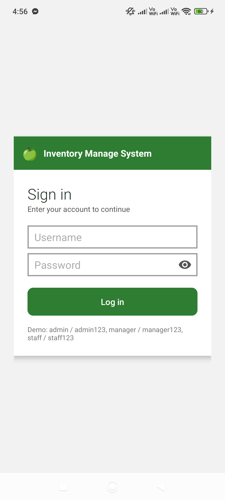
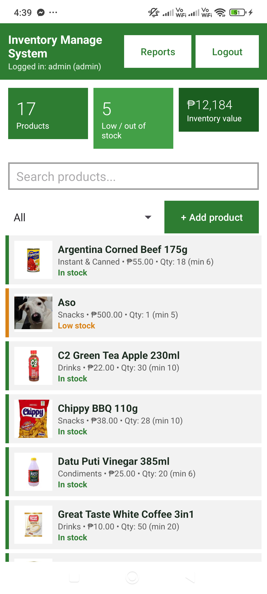

# Inventory Management System (ITLEC)

An Android inventory management app for a small retail / sari-sari store. It tracks products,
stock levels, sales and low-stock alerts, with **role-based access** for admins, managers and staff.

Built with **Java** and **Material 3** on top of a local **SQLite** database — no server required,
everything runs offline on the device.

---

## Screenshots

| Login | Product list |
|---|---|
|  |  |

---

## Demo accounts

The database is seeded on first launch with three accounts:

| Username | Password | Role |
|---|---|---|
| `admin` | `admin123` | Admin |
| `manager` | `manager123` | Manager |
| `staff` | `staff123` | Staff |

---

## Features

**Products**
- Add, edit and delete products (name, category, price, quantity, minimum stock)
- Attach a photo to any product — pick one from the gallery, it is scaled to 256 px and stored locally
- 16 common Philippine store products are pre-loaded, each with its product photo

**Stock**
- **Sell** — records the sale, blocks it when stock is insufficient
- **Restock** — adds units to the current quantity
- Colour-coded status per product: `In stock` (green), `Low stock` (orange), `Out of stock` (red)

**Dashboard**
- Live tiles: total products, low / out-of-stock count, total inventory value
- Search by product name
- Filter by category: Snacks, Drinks, Instant & Canned, Condiments, Household, Others

**Reports**
- Low-stock report listing every product at or below its minimum
- Inventory summary: products, units in stock, total inventory value
- Sales summary: transaction count, units sold, revenue, and the 10 most recent sales

---

## Roles and permissions

| Action | Admin | Manager | Staff |
|---|:---:|:---:|:---:|
| View products, search, filter | ✅ | ✅ | ✅ |
| Sell / Restock | ✅ | ✅ | ✅ |
| Add / Edit / Delete product | ✅ | ✅ | ❌ |
| Reports screen | ✅ | ✅ | ❌ |

Staff see only the product list and the sell/restock actions; the **Add product** and **Reports**
buttons are hidden for them, and `ReportsActivity` closes itself if opened without permission.

---

## Tech stack

| | |
|---|---|
| Language | Java 11 |
| Min / target SDK | 26 / 37 (compile SDK 37) |
| UI | XML layouts, Material Components 1.14.0 (Material 3) |
| Database | SQLite via `SQLiteOpenHelper` (`inventory.db`, version 2) |
| Build | Gradle (Kotlin DSL), Android Gradle Plugin 9.3.3 |
| Dependencies | AppCompat 1.8.0, Material 1.14.0, Activity 1.13.0, ConstraintLayout 2.2.2 |

---

## Getting started

**Requirements:** Android Studio (latest), JDK 11+, Android SDK 37, a device or emulator on API 26+.

```bash
git clone https://github.com/rakka-m/Inventory-Management-System---ITLEC.git
```

1. Open the folder in Android Studio.
2. Let Gradle sync (it downloads the wrapper + dependencies).
3. Press **Run** ▶️ on a connected device or emulator.

Command line:

```bash
./gradlew assembleDebug          # build the APK
./gradlew installDebug           # build + install on a connected device
```

> `local.properties` is intentionally **not** committed — Android Studio generates it with your
> local SDK path on first sync.

---

## Project structure

```
InventoryManagementSystem/
├── app/src/main/
│   ├── java/com/example/inventorymanagementsystem/
│   │   ├── LoginActivity.java      # sign-in, role lookup
│   │   ├── MainActivity.java       # dashboard, product list, sell/restock, add/edit dialogs
│   │   ├── ReportsActivity.java    # low stock, inventory and sales reports
│   │   └── DBHelper.java           # SQLite schema, seeding, queries
│   ├── res/
│   │   ├── layout/                 # activity_login, activity_main, activity_reports,
│   │   │                           # dialog_product, item_product
│   │   ├── drawable/               # icons and the green placeholder
│   │   ├── drawable-nodpi/         # 16 bundled product photos
│   │   └── values/                 # colors, strings, themes, styles
│   └── AndroidManifest.xml
├── gradle/libs.versions.toml       # dependency versions
└── build.gradle.kts, settings.gradle.kts
```

---

## Database

`inventory.db` is created automatically on first launch:

| Table | Columns |
|---|---|
| `users` | `username` (PK), `password`, `role` |
| `products` | `id` (PK), `name` (unique), `category`, `price`, `qty`, `min_qty`, `image` |
| `sales` | `id` (PK), `name`, `qty`, `total`, `by_user`, `time` |

- The 16 default products are inserted in `DBHelper.onCreate()` together with their photo name.
- `products.image` holds **either** a bundled drawable name (`piatos`, `milo`, …) **or** an absolute
  path to a photo the user picked (`/data/user/0/<package>/files/img_*.jpg`).
- `DBHelper.photoRes()` resolves a drawable name to a resource id; `MainActivity.showPhoto()`
  falls back to the file path and finally to the placeholder icon.
- Older databases that stored seeded photos as file paths are upgraded in place by
  `DBHelper.migrateLegacyImagePaths()` — no data is dropped.

---

## Notes

- Currency is Philippine peso (₱).
- The product photos in `res/drawable-nodpi/` are included for demonstration purposes only.
- This project was developed as an academic requirement for **ITLEC / HCI**.
